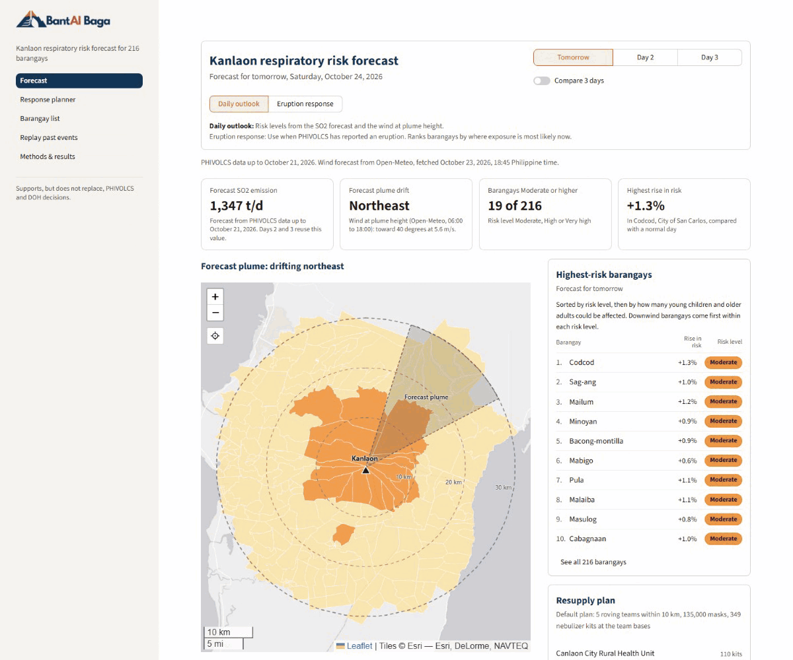
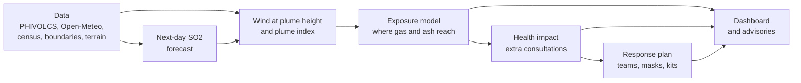
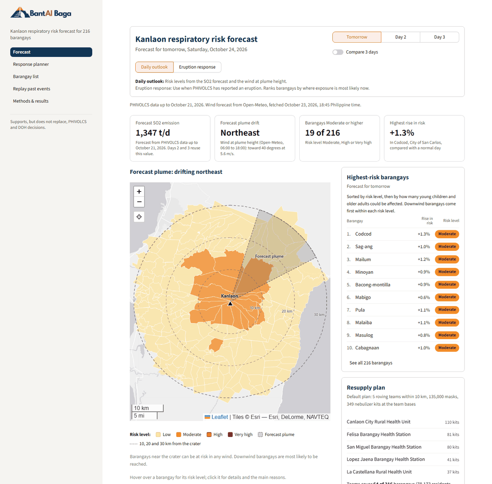
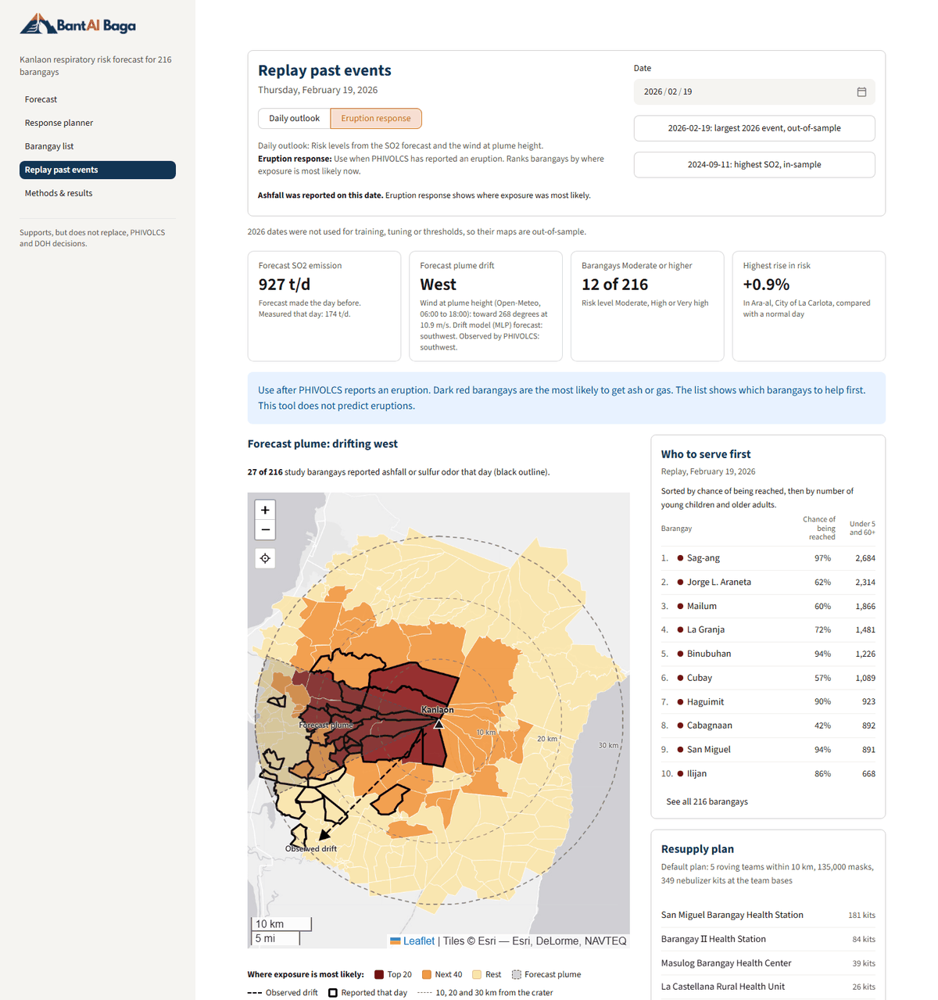
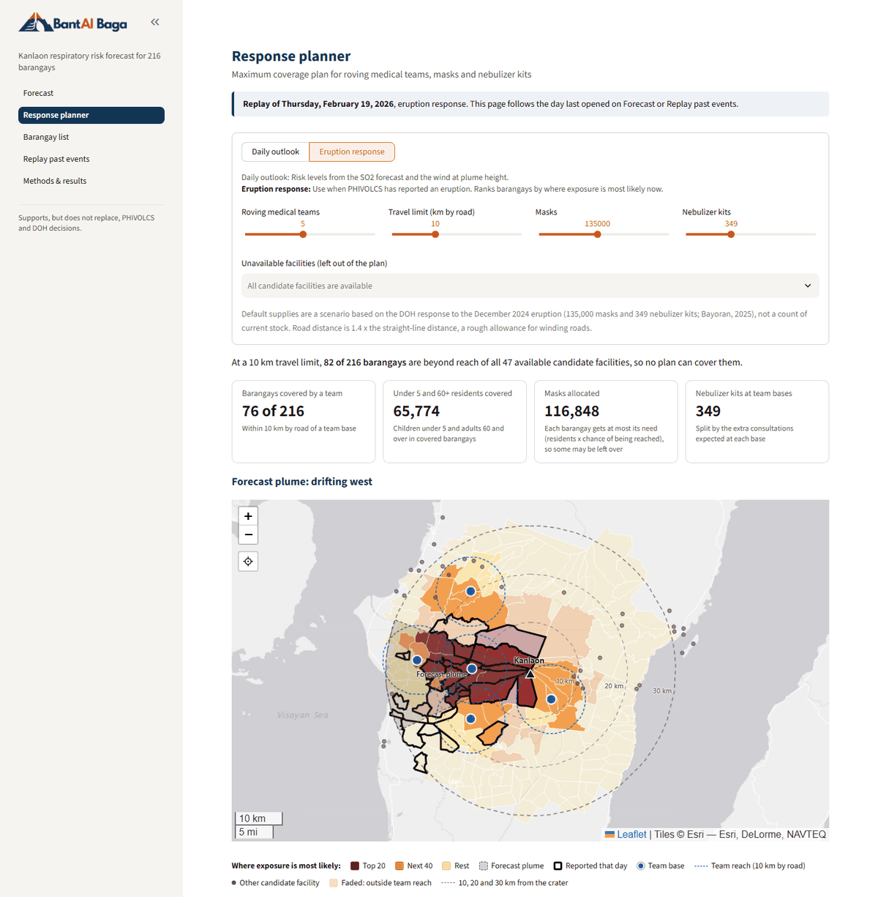
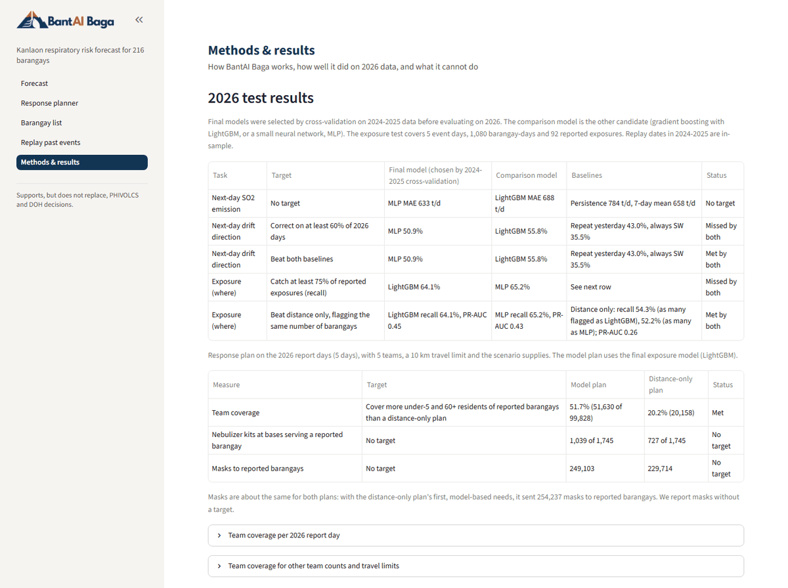

<div align="center">

<picture>
  <source media="(prefers-color-scheme: dark)" srcset="docs/images/logo_dark.png">
  <source media="(prefers-color-scheme: light)" srcset="app/assets/bantai_baga_logo.png">
  
</picture>

BantAI Baga forecasts which barangays near Kanlaon Volcano are likely to breathe volcanic gas and ash in the next 1 to 3 days, and plans where to send health teams and supplies.

[](https://www.python.org/downloads/) [](LIVE_APP_URL) [](LICENSE) [](../../actions/workflows/checks.yml)

[What it does](#what-it-does) · [How it works](#how-it-works) · [Dashboard](#using-the-dashboard) · [Results](#results-on-unseen-2026-data) · [Quick start](#quick-start-app-only) · [Reproduction](#full-reproduction) · [Data sources](#data-sources) · [Limitations](#limitations)

</div>



## What it does

BantAI Baga forecasts which barangays within 30 km of Kanlaon Volcano, on Negros Island in the Philippines, are likely to breathe volcanic gas and ash in the next 1 to 3 days. It estimates how much that exposure raises respiratory risk for children under 5 and adults 60 and over, and plans where to send roving medical teams, masks and nebulizer kits. Health workers use it through a Streamlit dashboard that also writes short advisories for residents in English, Hiligaynon and Cebuano.

> [!NOTE]
> BantAI Baga does not predict eruptions and does not measure air quality. It estimates where gas and ash are likely to reach, from PHIVOLCS emission records and forecast wind, and turns that into expected extra respiratory consultations under stated SO2 scenarios.

## How it works



**Data** (notebook 01). We combine PHIVOLCS SO2 emission, plume observations and daily earthquake counts with hourly Open-Meteo wind, SRTM elevation, the 2020 census and barangay boundaries. The study area is every barangay whose centroid lies within 30 km of the crater. We train on 2024-2025 and keep 2026 for testing only: nothing from 2026 is used for training, scaling, tuning or thresholds.

**Next-day SO2 forecast** (notebook 02). A model forecasts tomorrow's SO2 emission (t/d) from the SO2 of the past 7 days, earthquake counts, plume observations and wind speed. A second model forecasts tomorrow's plume direction from tomorrow's wind at plume height, the last observed drift and plume height. For each task we compare gradient boosting (LightGBM) with a small neural network (MLP).

**Wind at plume height and plume index** (notebooks 01 and 02). We interpolate the hourly wind between the 800 and 700 hPa levels to the plume's altitude and average it from 06:00 to 18:00. A Gaussian plume model then spreads the forecast emission downwind and gives each barangay a plume index.

**Exposure model** (notebook 02). A classifier trained on the 2024-2025 event days, with the barangays that reported sulfur odor or ashfall as positives, estimates p_exposed, the chance that gas or ash reaches each barangay if the volcano releases it. Its inputs are distance, direction and elevation, the angle from the plume direction, the plume index, SO2, plume height, wind speed and recent earthquake counts. SHAP values give the main reasons for each barangay's score. The model predicts where exposure happens on an event day, not which days have events.

**Health impact** (notebook 03). Expected extra consultations per day follow a standard health impact formula:

$$\Delta Y = P \times Y_0 \times \left(RR^{\Delta C / 10} - 1\right)$$

$P$ is the number of children under 5 or adults 60 and over, $Y_0$ the baseline daily rate of acute respiratory consultations from FHSIS 2022, and $RR$ the relative risk per 10 µg/m³ of 24-hour SO2. We have emission at the crater, not concentrations where people live, so the SO2 rise $\Delta C$ is a scenario:

$$\Delta C = p_{\text{exposed}} \times \min\left(\frac{Q}{q_{\text{ref}}},\ c\right) \times S$$

$Q$ is the forecast emission, $q_{\text{ref}}$ a reference emission from 2024-2025 report days, $c$ a cap, and $S$ the assumed rise for a barangay that is surely exposed on a typical report day. The values are listed under [Results](#results-on-unseen-2026-data).

**Response plan** (notebook 04). A maximum coverage integer program (PuLP with the CBC solver) chooses bases for the roving medical teams among health facilities from OpenStreetMap. A team covers a barangay when the approximate road distance is within the travel limit, and the program covers as many expected extra consultations among children under 5 and adults 60 and over as it can. Nebulizer kits go to the team bases in proportion to the extra consultations each base serves. Masks go first to barangays with the most expected extra consultations per resident, each up to its residents times its chance of being reached.

**Dashboard** (`app/`). The Streamlit dashboard runs the saved final SO2 and exposure models on the latest PHIVOLCS data and the Open-Meteo wind forecast, and shows past dates from the saved notebook outputs. Notebook 05 checks what drives the forecast; its findings are on the Methods & results page.

## Using the dashboard

- **Forecast**: risk map and ranked list for tomorrow, Day 2 and Day 3. *Daily outlook* shows risk levels from the SO2 forecast and the wind at plume height. *Eruption response*, for use after PHIVOLCS reports an eruption, ranks barangays by where exposure is most likely.
- **Response planner**: choose the number of teams, the travel limit, masks and kits, or leave out facilities that are unavailable, and get team bases, kits per base and masks per barangay.
- **Barangay list**: every study barangay in priority order, with search and a CSV download.
- **Replay past events**: saved model outputs for any date in the study period, with the barangays that reported ashfall or sulfur odor outlined.
- **Methods & results**: the 2026 test results, what drives the forecast, data sources and limitations.

<details>
<summary>Screenshots</summary>

**Forecast**, daily outlook for tomorrow



**Replay past events**, February 19, 2026, eruption response, with reported barangays outlined



**Response planner** for the same day



**Methods & results**



</details>

## Results on unseen 2026 data

Final models were chosen by 2024-2025 cross-validation before we tested them on 2026 data, and we did not change them after testing. We report every result, including the targets we missed. This section is generated from `results/` by `scripts/update_readme.py`.

<!-- RESULTS:START results -->

The 2026 test covers 265 days with an observed drift, 290 days with a measured next-day SO2 emission, and 5 event days with 1,080 barangay-days and 92 reported exposures. Status refers to the final model.

| Task | Target | Final model | Comparison model | Baselines | Status |
|---|---|---|---|---|---|
| Next-day SO2 emission | No target | MLP MAE 633 t/d | LightGBM MAE 688 t/d | Persistence 784 t/d, 7-day mean 658 t/d | No target |
| Next-day drift direction | Correct on at least 60% of 2026 days | MLP 50.9% | LightGBM 55.8% | Repeat yesterday 43.0%, always SW 35.5% | Missed |
| Next-day drift direction | Beat both baselines | MLP 50.9% | LightGBM 55.8% | Repeat yesterday 43.0%, always SW 35.5% | Met |
| Exposure (where) | Catch at least 75% of reported exposures (recall) | LightGBM 64.1% | MLP 65.2% | See next row | Missed |
| Exposure (where) | Beat distance only, flagging the same number of barangays | LightGBM recall 64.1%, PR-AUC 0.45 | MLP recall 65.2%, PR-AUC 0.43 | Distance only: recall 54.3% (as many flagged as LightGBM), 52.2% (as many as MLP); PR-AUC 0.26 | Met |

Response plan on the 5 report days of 2026, with 5 roving teams, a 10 km travel limit, 135,000 masks and 349 nebulizer kits. The model plan uses the final exposure model (LightGBM).

| Measure | Target | Model plan | Distance-only plan | Status |
|---|---|---|---|---|
| Team coverage | Cover more under-5 and 60+ residents of reported barangays than a distance-only plan | 51.7% (51,630 of 99,828) | 20.2% (20,158) | Met |
| Nebulizer kits at bases serving a reported barangay | No target | 1,039 of 1,745 | 727 of 1,745 | No target |
| Masks to reported barangays | No target | 249,103 | 229,714 | No target |

<details>
<summary>Team coverage per 2026 report day</summary>

| Date | Reported barangays | Under 5 and 60+ in reported barangays | Covered, model plan | Covered, distance-only plan | Difference |
|---|---|---|---|---|---|
| 2026-02-19 | 27 | 24,426 | 13,979 | 892 | 13,087 |
| 2026-02-26 | 22 | 23,430 | 14,565 | 892 | 13,673 |
| 2026-03-15 | 16 | 16,145 | 7,600 | 5,348 | 2,252 |
| 2026-07-09 | 16 | 22,360 | 13,026 | 13,026 | 0 |
| 2026-10-10 | 11 | 13,467 | 2,460 | 0 | 2,460 |

</details>

Settings: RR = 1.0126 per 10 µg/m³ of 24-hour SO2 (Carlsen et al., 2021); q_ref = 5,008 t/d, the median SO2 on the 8 report days of 2024-2025 with an SO2 reading; c = 3; main scenario S = 40 µg/m³.

<!-- RESULTS:END results -->

## Quick start (app only)

The dashboard runs from the small tables in `app/data`, so it needs no raw data. You need Python 3.12 and Git. Clone this repository, then from its folder:

Windows (PowerShell)

```powershell
py -3.12 -m venv .venv
.venv\Scripts\python -m pip install -r app/requirements.txt
.venv\Scripts\python -m streamlit run app/streamlit_app.py
```

macOS and Linux

```bash
python3.12 -m venv .venv
.venv/bin/python -m pip install -r app/requirements.txt
.venv/bin/python -m streamlit run app/streamlit_app.py
```

The app opens at http://localhost:8501. The Forecast page downloads the wind forecast from Open-Meteo; without an internet connection it shows the latest replay date instead.

## Full reproduction

1. Install the full environment, pinned to the versions that produced our results:

   ```bash
   python -m pip install -r requirements.txt
   ```

2. Get the data. [`data/README.md`](data/README.md) lists every raw file with its source, license and the notebook that uses it. `python scripts/download_open_data.py` downloads the open files into `data/raw/` and prints the steps for the PHIVOLCS and NASA SRTM files, which need a free account.
3. Run the pipeline:

   ```bash
   python scripts/run_pipeline.py
   ```

   It runs notebooks 01 to 05 in order without opening them, saves them with their outputs, rebuilds `app/data` with `app/build_app_data.py`, and compares the new `results/metrics.json` and `results/forecast_drivers.json` with the committed versions. It takes about 6 minutes on a laptop; notebook 02, which trains the models and computes SHAP values, takes the longest.
4. Read the result. **PASS** means every value in both files equals the committed value (numbers within a relative tolerance of 1e-6) and the copies in `app/data` match. Otherwise the script lists each value that changed and exits with an error. `python scripts/run_pipeline.py --check` runs only the comparison.

Our own run with the committed data printed PASS. Two things can change results on your machine: newer PHIVOLCS records or a newer OpenStreetMap snapshot (see [`data/README.md`](data/README.md#snapshots-and-versions)). The SHAP summary figure places overlapping points at random, so its image can differ slightly between runs while the numbers do not.

After a run, `python scripts/update_readme.py` rewrites the generated parts of this README, `python -m pytest tests` runs the dashboard tests, and `python app/check_forecast_consistency.py` checks that the live forecast code reproduces the saved 2026 scores. GitHub Actions runs the tests and both `--check` commands on every push.

## Repository structure

<details>
<summary>Folders and main files</summary>

```text
app/                          Streamlit dashboard
  streamlit_app.py            entry point and page menu
  views/                      one file per page
  components.py, risk_map.py  cards, lists, advisories and the map
  dashboard_data.py           data loading, live forecast and list order
  data/                       small tables, final models and metrics the app reads
  build_app_data.py           rebuilds app/data from the notebook outputs
  check_forecast_consistency.py  checks the live forecast code against the saved 2026 scores
  requirements.txt            packages for the app only
data/
  README.md                   every raw file: source, license, how to get it
  report_log/                 sulfur odor and ashfall reports per barangay and date
  reference/                  baseline consultation rates from FHSIS 2022
  raw/, processed/            downloaded files and notebook tables (not in git)
docs/images/                  README images
models/                       saved SO2, drift and exposure models (LightGBM and MLP)
notebooks/                    01 data preparation, 02 exposure forecasting, 03 health impact,
                              04 resource allocation, 05 forecast drivers
results/                      metrics.json, forecast_drivers.json, tables/ and figures/
scripts/                      data download, pipeline run and README update
src/                          functions shared by the notebooks and the app
tests/                        Streamlit AppTest suite
requirements.txt              full environment, pinned (Python 3.12)
```

</details>

## Data sources

<details>
<summary>Data</summary>

- Epidemiology Bureau, Department of Health. (n.d.). *Field Health Services Information System 2022 annual report*. https://doh.gov.ph/data-publications/fhsis-2022/
- Faeldon, J. (2024). *Philippines JSON maps* [Data set]. GitHub. https://github.com/faeldon/philippines-json-maps
- Humanitarian OpenStreetMap Team. (2026). *Philippines health facilities (OpenStreetMap export)* [Data set]. Humanitarian Data Exchange. https://data.humdata.org/dataset/hotosm_phl_health_facilities
- NASA Jet Propulsion Laboratory. (2013). *NASA Shuttle Radar Topography Mission Global 1 arc second* (Version 3) [Data set]. NASA EOSDIS Land Processes Distributed Active Archive Center. https://doi.org/10.5067/MEaSUREs/SRTM/SRTMGL1.003
- Open-Meteo. (2026a). *Historical forecast API* [Data set]. https://open-meteo.com/en/docs/historical-forecast-api
- Open-Meteo. (2026b). *Weather forecast API* [Data set]. https://open-meteo.com/en/docs
- Philippine Institute of Volcanology and Seismology. (2026). *Kanlaon Volcano SO2 flux, visual observation, and daily earthquake count records, January 2024 to October 2026* [Data set]. Local Active Volcanoes Archive. https://wovodat.phivolcs.dost.gov.ph/data/download
- Philippine Statistics Authority. (2023). *Philippines: Population by single-year age, sex and admin4 (barangay), Census 2020* [Data set]. Humanitarian Data Exchange. https://data.humdata.org/dataset/popn-single-year-age-sex-and-barangay-census-2020

The sulfur odor and ashfall report log (`data/report_log/report_log.csv`) links the source of each row: PHIVOLCS bulletins, news reports and local government posts.

</details>

<details>
<summary>Parameters and methods</summary>

- Bayoran, G. P. (2025, January 6). Respiratory infection, other illness hit Kanlaon-displaced residents. *Negros Now Daily*. https://negrosnowdaily.com/respiratory-infection-other-illness-hit-kanlaon-displaced-residents/
- Carlsen, H. K., Valdimarsdóttir, U. A., Briem, H., Dominici, F., Finnbjörnsdóttir, R. G., Jóhannsson, T., Aspelund, T., Gíslason, T., & Guðnason, T. (2021). Severe volcanic SO2 exposure and respiratory morbidity in the Icelandic population: A register study. *Environmental Health, 20*, Article 23. https://doi.org/10.1186/s12940-021-00698-y
- Wang, W., Wu, S., Wang, S., Zhen, L., & Qu, X. (2021). Emergency facility location problems in logistics: Status and perspectives. *Transportation Research Part E: Logistics and Transportation Review, 154*, Article 102465. https://doi.org/10.1016/j.tre.2021.102465
- World Health Organization. (2021). *WHO global air quality guidelines: Particulate matter (PM2.5 and PM10), ozone, nitrogen dioxide, sulfur dioxide and carbon monoxide*. https://iris.who.int/handle/10665/345329

</details>

## Limitations

<!-- RESULTS:START limitations -->

- Few events: the exposure model learned from 9 event days in 2024-2025 and was tested on 5 in 2026.
- The report log undercounts exposure: many news reports give only the number of affected barangays, and quiet days are rarely reported.
- The model predicts where exposure happens on an event day, not when events happen. Ashfall from sudden eruptions does not follow daily SO2.
- The exposure model was trained on report days only, so it ranks barangays even on quiet days; the daily outlook scales risk by forecast SO2 for this reason.
- SO2 levels are scenarios. We have emission at the crater (t/d), not concentrations where people live, so the SO2 rise assumes 40 µg/m³ for a barangay that is surely exposed on a typical report day.
- The FHSIS 2022 baseline is likely low, since it counts only cases reported through public health facilities.
- FHSIS 2022 has no rate for adults 60 and over, so we use the all-ages rate.
- Bacolod City uses its own FHSIS rate; Negros Oriental uses the Negros Occidental rate because its own figures look underreported.
- Health facilities come from OpenStreetMap, which may miss some barangay health stations.
- Past wind comes from Open-Meteo's historical record, which is a model analysis, not wind measured at the crater. The live forecast uses Open-Meteo's forecast, which adds forecast error.
- The live forecast holds the volcano inputs at the last data date, so it ages until new PHIVOLCS data are added.
- Travel distance is 1.4 x the straight-line distance, not a road network.
- Each advisory template was reviewed by one team member.

<!-- RESULTS:END limitations -->

## Responsible use

> [!IMPORTANT]
> BantAI Baga supports, but does not replace, PHIVOLCS and DOH decisions. Always follow official PHIVOLCS bulletins and DOH and local government instructions. The advisories are general guidance, not medical advice.

## Use of AI tools

AI assistants helped us write code and draft text, and the authors reviewed all outputs and results.

## License

The code is released under the [MIT License](LICENSE). Each data source keeps its own license or terms, listed in [`data/README.md`](data/README.md).
